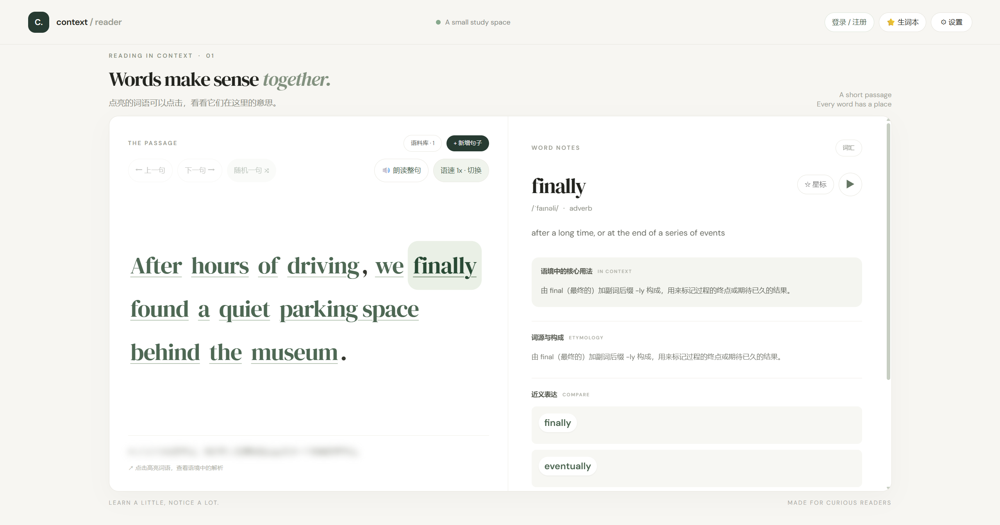
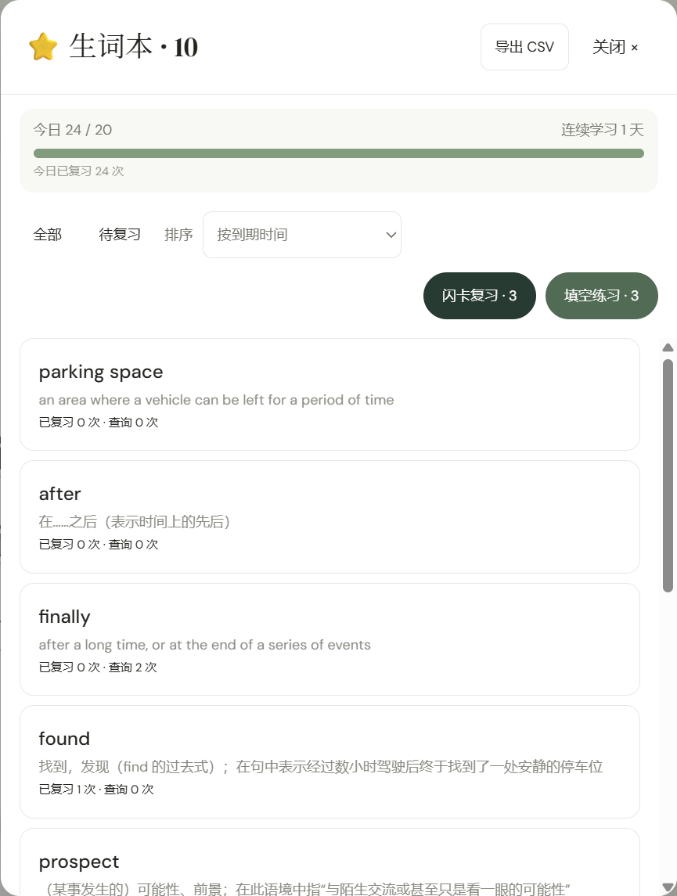

# context / reader

> 在语境里学单词：点击句子中的任意单词，立即看到它在**这句话里**的意思、词源与构成，再用星标生词本、闪卡和填空把它记住。

在线演示：<https://english-context-reader.vercel.app>





## 功能特性

### 阅读与解析
- **点词查义**：点击句子中的单词或短语，调用大模型生成结合语境的释义、音标、词性、词源与构成（前缀 / 词根 / 后缀）、近义表达
- **解析缓存**：同一个词的解析结果会缓存，再次点击不重复请求
- **遮住翻译**：中文翻译默认模糊，点击后显示，先自己理解再看答案（可在设置中关闭）
- **整句朗读**：基于浏览器 `speechSynthesis`，支持 0.7x / 1x 语速，另有单词发音
- **上一句 / 下一句 / 随机一句**，切换页面或刷新后仍停留在当前句子

### 语料库
- 手动新增句子，或**粘贴整篇文章自动拆句导入**（处理 `Mr.`、`e.g.`、小数点等缩写，导入前可预览并勾选）
- **自动翻译**：中文留空的句子由大模型分批翻译，后台进行，可重试失败的句子
- 搜索、删除（带撤销）、按句子文本自动去重

### 生词本与复习
- 每个词条可加**星标**，进入生词本
- **闪卡复习**：正面单词，翻面看解析，按「不认识 / 模糊 / 认识」反馈
- **填空练习**：把原句中的目标词挖空，自己输入；词形变化（如 `contradicting` 与 `contradict`）会提示而不直接判错
- **间隔复习**：根据反馈安排下次复习时间（不认识约 10 分钟后；模糊 1 天后；认识则按 1、2、4、7、15、30 天逐档拉长）
- **加练模式**：不受到期时间限制，随时练习，且不影响复习计划
- 记录每个词的**查询次数**，可按次数排序，优先复习真正难的词
- **每日复习目标**与**连续学习天数**
- 导出 CSV 格式，支持数据备份与恢复

### 账号与同步
- 邮箱 + 密码注册 / 登录 / 重置密码（Supabase Auth）
- 登录后句子、词条、星标、复习进度**云端同步**，多设备可用
- 未登录时使用 `localStorage` 本地模式；登录时若本地有自定义句子，会**询问是否导入**到账号，避免共用电脑时数据串号
- 生词本与星标需要登录后使用

### 其他
- 响应式布局，适配手机

## 技术栈

| 部分 | 技术 |
|---|---|
| 前端 | Vue 3、Vite、Tailwind CSS |
| 账号与数据库 | Supabase（Auth + PostgreSQL + 行级安全 RLS） |
| 大模型 | DeepSeek API（兼容 OpenAI 格式，可在设置中更换地址与模型） |
| 部署 | Vercel |

## 快速开始

### 1. 克隆并安装

```bash
git clone https://github.com/HendySen01/english-context-reader.git
cd english-context-reader
npm install
```

### 2. 配置环境变量

在项目根目录新建 `.env.local`（该文件已被 `.gitignore` 忽略，不会上传）：

```env
VITE_SUPABASE_URL=https://你的项目ID.supabase.co
VITE_SUPABASE_ANON_KEY=你的 anon public key
```

注意：值**不要加引号、不要有空格**，URL 只写到域名为止，不要带 `/rest/v1/` 之类的路径。

### 3. 初始化数据库

在 Supabase 后台的 **SQL Editor** 中依次执行：

```sql
-- 句子表
create table sentences (
  id uuid default gen_random_uuid() primary key,
  user_id uuid references auth.users not null,
  english text not null,
  chinese text,
  created_at timestamp with time zone default timezone('utc'::text, now()) not null,
  constraint sentences_user_english_unique unique (user_id, english)
);

-- 词条表（解析缓存 + 星标 + 复习进度 + 查询次数）
create table word_notes (
  id uuid default gen_random_uuid() primary key,
  user_id uuid references auth.users not null,
  word text not null,
  data jsonb not null,
  updated_at timestamp with time zone default timezone('utc'::text, now()) not null,
  is_starred boolean default false not null,
  review_count integer default 0 not null,
  next_review_at timestamp with time zone default timezone('utc'::text, now()) not null,
  lookup_count integer default 0 not null,
  unique (user_id, word)
);

-- 复习记录表（用于今日统计与连续学习天数）
create table review_logs (
  id uuid default gen_random_uuid() primary key,
  user_id uuid references auth.users not null,
  word text not null,
  result text not null check (result in ('know', 'vague', 'unknown')),
  reviewed_at timestamp with time zone default timezone('utc'::text, now()) not null
);

-- 开启行级安全：用户只能读写自己的数据
alter table sentences   enable row level security;
alter table word_notes  enable row level security;
alter table review_logs enable row level security;

create policy "用户只能管理自己的句子" on sentences
  for all using (auth.uid() = user_id) with check (auth.uid() = user_id);

create policy "用户只能管理自己的词条" on word_notes
  for all using (auth.uid() = user_id) with check (auth.uid() = user_id);

create policy "用户只能管理自己的复习记录" on review_logs
  for all using (auth.uid() = user_id) with check (auth.uid() = user_id);

-- 方便按「是否星标」和「到期时间」筛选
create index if not exists idx_word_notes_user_star_review
  on word_notes (user_id, is_starred, next_review_at);

create index if not exists idx_review_logs_user_time
  on review_logs (user_id, reviewed_at);
```

### 4. 配置大模型

启动后打开页面右上角 **设置**，填写：

- 接口地址（DeepSeek 默认为 `https://api.deepseek.com`）
- 模型名（如 `deepseek-chat`）
- 你自己的 API Key

这些信息只保存在你自己浏览器的 `localStorage` 中。

### 5. 运行

```bash
npm run dev      # 本地开发
npm run build    # 生产构建
npm run preview  # 预览构建结果
```

## 部署到 Vercel

1. 将仓库导入 Vercel
2. 在 **Settings → Environment Variables** 添加 `VITE_SUPABASE_URL` 和 `VITE_SUPABASE_ANON_KEY`，Environment 全选
3. **Redeploy**（Vite 的环境变量在构建时写入代码，修改后必须重新部署才生效）
4. 在 Supabase 后台 **Authentication → URL Configuration** 中，把你的线上域名加入 *Site URL* 与 *Redirect URLs*，否则验证邮件中的链接会跳回 localhost

## 部署到阿里云 ECS

Docker Compose 构建、代理安全、验收、更新和回滚见 [ECS 部署文档](deploy/README.md)。

## 项目结构

```
src/
├── App.vue                  页面主体：状态、云端同步、阅读区、词条解析、生词本
├── main.js
├── components/
│   ├── AuthModal.vue        登录 / 注册 / 重置密码
│   ├── SettingsModal.vue    设置（遮住翻译、每日目标、API、备份导入导出）
│   └── ImportConfirmModal.vue  登录后「导入本地数据到账号」确认
└── lib/                     不依赖 Vue 的纯函数
    ├── supabase.js          Supabase 客户端
    ├── srs.js               复习间隔计算
    ├── text.js              分词、拆句、整词匹配、词形判断
    ├── sentences.js         句子去重、合并、缺翻译判断
    ├── csv.js               CSV / Anki 导出
    ├── backup.js            备份生成与解析
    ├── date.js              本地日期与连续学习天数
    └── storage.js           localStorage 安全读写
```

## 数据与隐私

- **数据隔离**：所有表都开启了 RLS，用户只能读写 `user_id` 等于自己的行；Supabase 的 anon key 设计上可以公开，安全由 RLS 保证
- **API Key**：大模型 Key 由用户在设置中自行填写，仅存于本机浏览器，**不要**把自己的 Key 配成以 `VITE_` 开头的环境变量，那样会被打包进前端代码并暴露给所有访问者
- **本地模式**：未登录时所有数据仅保存在浏览器 `localStorage`，清除浏览器数据会丢失，建议使用「备份导出」

## 已知限制与后续计划

- 浏览器通过同源 `/api/llm` 请求模型。ECS 使用服务器密钥和账号授权，Vercel 与 Vite 开发环境各自使用原有代理。
- `word_notes` 以 `(user_id, word)` 为唯一键，同一个词在多个句子中的解析会共用一条记录
- 计划继续拆分 `App.vue`（生词本、阅读区、词条解析区、状态逻辑）

## 许可证

本项目基于 [MIT 许可证](LICENSE) 开源，详情请查看 [LICENSE](LICENSE) 文件。
